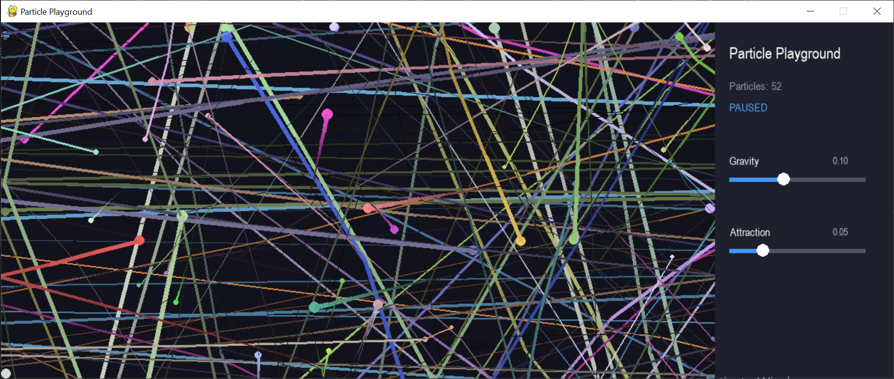

# Particle-Playground

A real time particle simulation built with **Python and Pygame** featuring particle creation, physics-based movement, gravity, wall collision, particle trails and mouse interaction.

Particle Playground is a hands-on exploration of physics simulation, object oriented programming and real time graphics using python.

## Why I Made this 

As I grow as a programmer, my understanding of the fundamentals principles of mathematics and physics continues to deepen. This project was motivated by my desire to bring these twp fields together through programming. Particle Playground is a stepping stone in that journey, allowing me to explore how mathematical and physical concepts can be translated into interactive simulations while developing my ability to apply what i learned in practical ways.

## Features 
- **Particle Generation:** Creates particles with randomized velocities and appearances.
- **Physics Simulation:** Particles move dynamically using velocity and gravity.
- **Wall Collision:** Particles bounce when they reach the boundaries of the simulated window
- **Particle Trails:** Particles leave visual trails behind them, creating motion effects.
- **Mouse Attraction:** Interacts with particles using the mouse.
- **Particle Management:** Add, remove, and clear particles dynamically.
- **Pause and Resume:** Control the simulation in real time
- **Interactive interface:** A dedicated control panel displays simulated information

## Controls
| Input | Action |
| --- | --- |
| left Mouse button | Spawns Particles |
| Right Mouse button | Remove the nearest particle |
| Mouse Movement | Interact with particle Attraction |
| `SPACE` | Pause / resume Simulation |
| `R` | Reset Simulation

